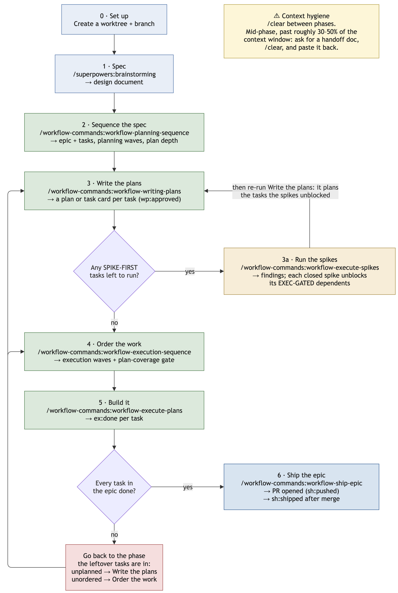

# Beadspowers: Python

Beadspowers is a Claude Code workflow for Python projects that combines **Beads** issue tracking with the **Superpowers** plan → execute → verify lifecycle, and enforces the order. Work one task at a time with you in the loop, or hand Claude a whole epic to plan and build across parallel agents.

1.Ask claude code to create a new worktree and branch
2. Drop the PRD, say "workflow sequence plans *prd/spec file name*": This command creates a Bead epic with tasks and sequence the tasks in order with which needs to be planned and executed before others can be. Output ins a sequence plan markdown and a Beads Epic Bead Tasks (type show me the beads epic and its tasks to see them)
3. Take the sequence md file it outputs out and say "workflow writing plans *sequence file name*" 
4. Clear session
5. Take the plans it outsputs and say "workflow execute plans *beads epic id*" 
6. Clear Session
7. Most likely your Beads Epic has many tasks and you are not done, so the workflow will remind you if you should go back to "workflow writing plans" or "workflow execute plans"
8. Say workflow ship epic Ship epic (creates CR or local if there is no package

**Context tip:** past roughly 30–50% of the context window in the middle of a phase, ask Claude for a handoff doc for the next session, `/clear`, and paste the doc back in.


## An epic

The epic workflow is for work too big to drive one task at a time: a spec that turns into many tasks, some depending on others and some with open questions. Run one by one, that keeps you in the loop for every step and wastes the parallelism; run all at once with no structure, the agents collide on the same files and the decisions behind them get lost. So the pipeline turns a brainstormed spec (Superpowers) into a Beads epic whose tasks are sequenced into waves and given a plan depth — a full plan, a lite plan or a test-first task card — and answers the open questions with throwaway spikes before planning what depends on them. It then executes the approved plans as parallel Claude Code agents, each in its own git worktree (tasks that need you, such as smoke tests, run one at a time in the main session). Each task is built test-first and verified at a tier sized to its diff: ruff, mypy and pytest always, with review agents and a Codex adversarial pass added at the full tier. Beads labels record every task's progress, so an interrupted run resumes where it stopped; a budget gate shows the cost before each fan-out; and shipping opens one PR for the whole epic, which counts as shipped only after the merge is confirmed.




## What's inside

- `.claude/rules/` — the router (`0_Beads x Superpowers/beads-workflow-router.md`) and the rules it enforces; start here.
- `.claude/Commands/workflow-commands/` — the single-task and epic-batch commands, plus the `python-verification-*` tiers.
- `.claude/agents/` — the review agents the full verification tier runs.
- `.claude/skills/` — troubleshooting skills, such as beads in a worktree.

## Set up

1. Install the system tools (the workflow is verified with beads 1.0.4):

   ```bash
   brew install jq gh
   gh auth login
   npm install -g @beads/bd
   ```

2. Install the plugins, inside Claude Code:

   ```
   /plugin marketplace add steveyegge/beads
   /plugin install beads@beads-marketplace
   /plugin install superpowers@claude-plugins-official
   /plugin install commit-commands@claude-plugins-official
   /plugin marketplace add openai/codex-plugin-cc (optional for adversarial review)
   /plugin install codex@openai-codex (optional for adversarial review)
   ```

3. Copy the workflow in. It works at either level, so pick one:

   - **User level (recommended)** — once, and it works in every project:

     ```bash
     cp -Rn /path/to/beadspowers-python/.claude/. ~/.claude/
     ```

   - **Project level** — only for one project, from its root:

     ```bash
     cp -Rn /path/to/beadspowers-python/.claude/. .claude/
     ```

   `cp -n` never overwrites a file you already have: it skips it silently and exits 1, so a same-named file already there keeps running, and re-copying never updates it. Avoid installing at both levels: a command that exists in both loads the user-level copy. Paths in the rules such as `.claude/Commands/...` mean `~/.claude/Commands/...` after a user-level install.

4. In each new project, run `/beads:init` before you start the workflow, then ask Claude to finish the beads setup. It follows the "Setting up a new project" steps in the workflow's `beads.md` rule (untracked export, ignored state files, a seeded Dolt remote) and fills in project values such as `src/<your_package>/` as it works.
